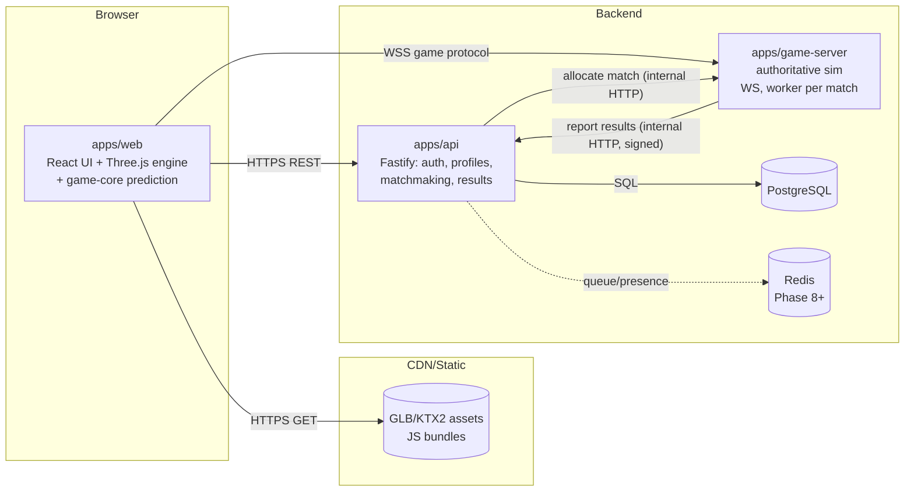

# Phase 1 — Technical Architecture & Blueprint

Status: **Draft, awaiting approval** · Date: 2026-11-21 · Scope: whole product, with the first vertical slice called out explicitly.

> Repo name is `bgmi-clone` (owner's choice). In-game branding, logos, map, weapons, characters and audio are **original or properly licensed**. Nothing is taken from BGMI, PUBG or Krafton. The player-facing game title gets its own original name before any public build.

---

## A. Executive technical overview

A browser battle royale that grows from a **4–8 player vertical slice** to a large-scale product **without a rewrite**. Three decisions carry most of that:

1. **One simulation, two hosts.** All gameplay rules (movement, weapons, damage, zone, inventory, match state) live in one pure-TypeScript package, `@br/game-core`, with no DOM and no rendering. The authoritative server runs it for real. The browser runs the same code only to *predict* the local player. Gameplay logic is never duplicated, so prediction and authority cannot drift apart.
2. **Server-authoritative everything.** Clients send *inputs* (buttons, aim angles, sequence numbers), never positions, hits, damage or inventory changes. The server simulates, validates and broadcasts snapshots.
3. **Hard module boundaries from day one, minimal features.** The slice ships only what it needs (one map, a few weapons, solo mode, guest accounts), but every boundary that a later feature plugs into (transport, matchmaking, persistence, renderer backend, asset streaming) exists as an interface now.

Priority order (owner's): gameplay quality → stable multiplayer → responsive controls → realistic graphics → production reliability.

### Approaches considered (decisions are the architect's calls unless noted)

| Decision | Options | Pick | Why |
|---|---|---|---|
| Render layer | (a) React Three Fiber for the whole scene · (b) **imperative Three.js engine + React only for UI/HUD** | **(b)** | A game loop needs full control of frame timing, pooling and allocation. R3F's reconciler adds GC pressure and indirection in the hot path. React stays where it shines: menus, HUD, inventory, settings. |
| Renderer backend | (a) `WebGLRenderer` + GLSL · (b) **`WebGPURenderer` + TSL node materials (auto-falls back to WebGL2)** | **(b), validated by a spike** | Writing materials in TSL once runs on both WebGPU and WebGL2. Starting on GLSL means rewriting every material later. Risk: the WebGL2 backend of `WebGPURenderer` can lag `WebGLRenderer` in performance. **Phase 3, week 1 spike** benchmarks both on the test map. If WebGL2-backend perf misses budget by >20%, fall back to (a) behind the same `RendererBackend` interface. |
| Physics | (a) custom collision · (b) cannon-es · (c) **Rapier 3D, deterministic build, on both client and server** | **(c)** | Same WASM binary on both ends gives bit-identical results, which makes reconciliation cheap and exact. Built-in kinematic character controller, heightfields, fast raycasts. |
| Transport | (a) **WebSocket now, behind a `Transport` interface** · (b) WebTransport/datagrams now | **(a)** | WebSocket works everywhere and through every proxy. TCP head-of-line blocking hurts under packet loss, so the protocol is designed for unreliable delivery (redundant inputs, delta snapshots vs last ack) and WebTransport drops in later (Phase 8+) without protocol changes. |
| Wire format | (a) JSON everywhere · (b) protobuf/flatbuffers · (c) **JSON+zod for control messages, hand-rolled bit-packed binary for the hot path** | **(c)** | Control traffic (join, chat, inventory actions) is rare: readable and schema-validated. Inputs and snapshots are 20–60 Hz: binary with quantization, delta compression and bounds-checked decoding. No codegen toolchain. |
| Server concurrency | (a) all matches on one event loop · (b) **one match per `worker_thread`, N workers per process** | **(b)** | A heavy match can't stall another. GC pauses are isolated. Slice runs 1 worker. |
| Hit detection | (a) client-reported hits, server sanity check · (b) **server-simulated projectiles with lag compensation** | **(b)** | Owner's rule: never trust client hits. Bullet velocity and drop are part of the design, so hitscan is not enough. |
| Matchmaking store | (a) Redis from day one · (b) **in-memory queue behind `MatchQueue` interface, Redis adapter when the API runs >1 instance** | **(b)** | Owner: "Redis when justified". It becomes justified at horizontal scale (Phase 8). The interface is fixed now. |
| Accounts in slice | (a) full email/password · (b) **guest accounts (device-bound) persisted in Postgres, upgradeable later** | **(b)** | Real persistence and auth tokens from the start. Password/OAuth flows come in Phase 7 on the same tables. |

---

## B. System architecture



### What runs where

| Location | Responsibilities |
|---|---|
| **Browser** | Rendering, audio, input capture, UI, local-player *prediction* using `game-core`, remote-entity interpolation, asset streaming. **Never** decides damage, health, death, ammo, loot ownership, zone or outcome. |
| **Authoritative game server** | Fixed-tick simulation of each match, input validation, movement, ballistics, lag compensation, damage, inventory transactions, zone, match state machine, snapshots, interest management, anti-cheat signals. |
| **Persistent backend (API)** | Guest/user accounts, token issuance, profiles, settings, matchmaking queue, server allocation, results ingestion, stats, bans, reports. |
| **PostgreSQL** | Everything that must survive restarts: users, profiles, stats, match history/results, bans, reports, settings, refresh tokens. |
| **Redis (Phase 8+)** | Ephemeral, rebuildable data only: matchmaking queues, presence, party state, game-server registry and heartbeats, rate-limit counters. Losing Redis loses queues, never progress. |
| **CDN / static hosting** | Web bundle, GLB/KTX2/audio assets with content-hashed filenames and immutable caching. Also serves map collision data to game servers at boot. |

### Independently scalable components
- **Web/assets**: infinite (static).
- **API**: stateless, horizontal behind a load balancer once matchmaking moves to Redis.
- **Game servers**: horizontal by match count; each process hosts N match workers and registers capacity. Later managed by Agones (Kubernetes) or a simple allocator on VPS fleets.
- **Postgres**: vertical first, read replicas for stats/history later.

---

## C. Frontend architecture (`apps/web`)

```
apps/web/src/
  app/            React shell: routes (loading, login, lobby, settings, match, results)
  ui/             HUD, inventory, map, menus (React + Tailwind, Zustand stores)
  engine/         imperative runtime — no React imports
    loop/         frame loop, fixed-step accumulator for prediction, timing
    render/       RendererBackend (WebGPU/WebGL2), scene graph, materials (TSL), post-fx
    world/        terrain chunks, streaming, LOD, instanced foliage, buildings
    entities/     view objects for players, loot, projectiles, vehicles (pooled)
    animation/    animation state machine + blend trees over three AnimationMixer
    camera/       TPP/FPP rig, shoulder swap, collision, recoil, shake, ADS
    input/        action map, bindings, pointer lock, gamepad, touch (later)
    audio/        Web Audio graph, 3D positional, pooled voices
    net/          client netcode: connection, prediction, reconciliation, interpolation
    assets/       loader (GLTF + KTX2 + meshopt), cache, disposal, memory budget
  bridge/         narrow event bus engine → UI (HUD values) and UI → engine (commands)
```

Rules:
- `engine/` never imports React; `ui/` never touches Three.js objects. They talk only via `bridge/` (typed events plus Zustand stores updated at most 10 Hz for HUD).
- The frame loop runs `requestAnimationFrame` for rendering and a **fixed 60 Hz accumulator** for prediction steps of `game-core`.
- Every pooled object has explicit `acquire/release`; every GPU resource is tracked by the asset manager and disposed on chunk unload or match exit.
- Graphics presets (Low/Medium/High/Ultra) are data in `@br/game-config`. A capability probe at boot (WebGPU availability, max texture size, a short GPU benchmark) picks the default. Dynamic resolution scales the render target between 0.6× and 1.0× to hold the frame-time budget.

### Controls (PC-first, rebindable)
Default map exactly as specified (WASD, mouse, LMB fire, RMB ADS, Shift, C, Z, Space, R, F, Tab, M, 1/2/3, Q/E, V, Esc). Implemented as **actions**, not keys. `input/` resolves physical input → action → per-tick `InputFrame`. Hold/toggle per action, sensitivity (hip/ADS/scope separately), profiles saved to the server settings table. Raw mouse deltas come via Pointer Lock with `unadjustedMovement: true` where supported, so OS acceleration is off. Gamepad (Phase 7) and touch (Phase 7) are additional input sources for the same action map.

---

## D. Backend architecture

### `apps/api` (Fastify, stateless)
Modules: `auth`, `profiles`, `settings`, `matchmaking`, `allocation`, `results`, `moderation`, `health`.
- **Auth:** guest login creates a user row and returns an **access token (EdDSA JWT, 15 min)** plus a **refresh token (opaque, hashed in DB, 30 days, rotated on use)**. Password and OAuth come later on the same tables.
- **Matchmaking:** `POST /v1/queue` (mode, region) → `MatchQueue` interface. When a match is formed, `allocation` asks a game server with capacity to create it, then returns to each player a **match ticket**: a short-lived (60 s) EdDSA-signed token with `{matchId, userId, team, serverUrl, nonce, exp}`.
- **Results:** game servers POST signed results. Ingestion is idempotent on `match_id` and runs in one transaction.
- Validation: every route has a JSON schema (zod → Fastify). Rate limits per IP and per user. Structured logs (pino) with request IDs.

### `apps/game-server`
- One **host process** exposes WSS plus an internal HTTP control API (create match, health, capacity, drain).
- Each match runs in a **worker thread** owning a `MatchInstance`: Rapier world, `game-core` simulation, network sessions.
- The host verifies the match ticket's signature with the API's **public key** (no DB call, no shared secret) and routes the socket to the right worker. Each nonce is used once.
- Fixed tick (default **30 Hz**, configurable up to 60). Tick-time metrics are recorded per match. Graceful drain: on SIGTERM, stop accepting new matches, let running ones finish (with a max time), then exit.

### Matchmaking split
The slice keeps matchmaking inside `apps/api` as a module. It is extracted into `apps/matchmaking` only when its load or release cadence justifies it. The interface and the ticket protocol stay identical, so extraction is a deployment change, not a rewrite.

---

## E. Multiplayer networking architecture

### Connection lifecycle
1. Client opens `wss://<gs>/v1/play?ticket=…`. The host validates the ticket, nonce, expiry and protocol version (`Hello{protocolVersion, buildHash}`). A mismatch closes the socket with a typed reason.
2. Worker sends `Welcome{entityId, tickRate, serverTick, mapId, matchConfig}`. Client loads the map, then sends `Ready`.
3. Steady state: inputs up, snapshots down, reliable events both ways.
4. **Heartbeat**: ping/pong every 1 s for RTT/jitter measurement. 5 s with no traffic = disconnect.
5. **Reconnect:** while the match is running, the player's entity stays in the world (vulnerable, idle) for a 60 s grace window. The client gets a reconnect token in `Welcome` and can rejoin with it. After the grace window, the player is eliminated.

### Message channels (logical)
| Channel | Direction | Rate | Encoding | Delivery semantics |
|---|---|---|---|---|
| `Input` | C→S | 60 Hz, batched per 2 frames | binary | each packet carries the last 4 frames (redundancy) |
| `Snapshot` | S→C | 20 Hz (configurable) | binary, delta vs last acked | client acks newest snapshot tick |
| `Event` | both | on demand | JSON + zod | reliable, ordered: kills, pickups, zone phase, chat |
| `Command` | C→S | on demand | JSON + zod | inventory moves, interact, drop. Server replies `CommandResult` |

All schemas live in `@br/protocol`, versioned by a single `PROTOCOL_VERSION`. Every decoder validates lengths, enums, numeric ranges and NaN/Infinity before anything reaches the sim. A malformed message is dropped and counted, and repeated offences disconnect the client.

### InputFrame
`{seq, clientTick, moveX:int8, moveY:int8, yaw:uint16, pitch:int16, buttons:bitfield(fire, ads, sprint, crouch, prone, jump, reload, interact, leanL, leanR, …), weaponSlot}`. Movement is direction intent only. The server clamps and normalizes. Aim angles are quantized and the yaw delta per tick is rate-limited (anti-spin).

### Prediction & reconciliation (local player)
- The client applies each `InputFrame` immediately through `game-core.stepPlayer()` (same Rapier deterministic build), stores `{seq, predictedState}` in a ring buffer.
- Each snapshot includes `lastProcessedInputSeq` for this client. The client compares the authoritative state for that seq to its prediction. If it differs beyond an epsilon, it resets to the server state and replays the unacked inputs. Visual error is smoothed over ~100 ms so corrections don't snap the camera.
- Only the local player and their own projectiles' muzzle effects are predicted. Damage, kills and inventory are never predicted beyond cosmetic feedback (e.g., the hit marker is shown **only on server confirmation**, sent within the next snapshot ~50 ms later).

### Interpolation (everyone else)
Remote entities render at `serverTime − interpDelay` (default 100 ms = 2 snapshots), interpolating between buffered snapshots. Extrapolation is capped at 250 ms on loss, then freeze.

### Lag compensation & ballistics
- The server keeps a **1 s ring buffer of hitbox poses** per player (capsules for head/torso/limbs).
- On `fire`, the server computes the shooter's **view time** = `now − RTT/2 − interpDelay`, clamped to **≤ 250 ms** in the past.
- A projectile is spawned on the server with weapon muzzle velocity and gravity. Each server tick it advances, and its segment is tested against hitboxes **rewound by the same view-time offset fixed at fire time**. World geometry is static, so it's tested at present time.
- Hits produce damage via the weapon/armor/hit-zone tables in `game-config`. The result is broadcast as events (hit marker to shooter, damage indicator to victim).

### Bandwidth & interest management
- Uniform grid (64 m cells). Each client receives full-rate updates for entities within ~300 m, reduced-rate (5 Hz) to ~1 km, and nothing beyond (except teammates, aircraft, zone). This also starves ESP cheats of data.
- Snapshot encoding: quantized positions (1 cm in a 16 km cube with 21-bit axes), smallest-three quaternions, field-change bitmasks, delta vs last acked baseline, full keyframe on desync.
- Budget: **≤ 40 kbps down / ≤ 16 kbps up per client at 8 players**; ≤ 150 kbps down at 100 players with interest management.

### Rate limiting
Per connection: input packets ≤ 40/s, commands ≤ 20/s, events ≤ 5/s. Token buckets, and violations escalate drop → warn → kick.

---

## F. Database schema (PostgreSQL, migrations via `node-pg-migrate`, queries via Kysely)

```sql
users              (id uuid pk, kind text check (kind in ('guest','registered')), email citext unique null,
                    password_hash text null, created_at, last_login_at, status text default 'active')
refresh_tokens     (id uuid pk, user_id fk→users on delete cascade, token_hash bytea unique, expires_at,
                    rotated_from uuid null, revoked_at null, created_at)        idx(user_id)
player_profiles    (user_id pk fk→users, display_name text unique, avatar_id text, level int, xp bigint, updated_at)
player_settings    (user_id pk fk→users, version int, payload jsonb, updated_at)   -- controls, graphics, audio
player_statistics  (user_id pk fk→users, matches int, wins int, kills int, deaths int, damage bigint,
                    top10 int, time_alive_s bigint, updated_at)
matches            (id uuid pk, mode text, map_id text, region text, server_id text, started_at, ended_at,
                    status text check (status in ('running','completed','aborted')), build_hash text)
match_participants (match_id fk→matches, user_id fk→users, team int, placement int, kills int, damage int,
                    survived_s int, primary key (match_id, user_id))           idx(user_id, match_id)
bans               (id uuid pk, user_id fk→users, reason text, issued_by text, starts_at, ends_at null)  idx(user_id)
reports            (id uuid pk, reporter_id fk, reported_id fk, match_id fk null, category text, details text,
                    status text, created_at)                                   idx(reported_id, status)
```

- **Transaction boundary:** results ingestion = insert `matches` (or update to completed) + all `match_participants` + increment `player_statistics`, in one transaction, idempotent on `match_id`.
- In-match inventory and loadouts are **ephemeral match state**, not DB rows. Persistent `loadouts` (cosmetics) and `friends`/`parties` tables arrive with those features. Parties live in Redis, friends in Postgres.
- The DB role used by the API has DML only on these tables, no DDL. Migrations run with a separate role.

---

## G. Game engine architecture (`@br/game-core`, shared)

Pure TS, deterministic given (state, inputs, config, seed). No `Date.now()`, no `Math.random()` (seeded PRNG), no DOM.

```
packages/game-core/src/
  sim/        World, fixed-step scheduler, entity registry (simple ECS: typed component stores)
  player/     movement controller (walk/sprint/crouch/prone/jump/fall/swim/vault/lean), stamina
  combat/     weapon state machine (fire modes, reload, switch, ADS), recoil & spread, projectiles, damage
  inventory/  slots, backpack capacity, transactions (pure functions: state + command → result | error)
  loot/       spawn tables, rarity, world loot entities
  zone/       circle schedule, shrink interpolation, damage per phase
  match/      match state machine
  physics/    Rapier adapter: character controller, heightfield, static colliders, raycasts
```

**Match state machine:** `Lobby(waiting for N or timeout) → Aircraft(flight path) → Deploying(freefall/parachute) → InProgress(zone phases 1..K) → Ending(winner) → Closed`. Each transition is a pure function of state + time and is unit-tested.

**Data-driven content** in `@br/game-config` (validated by zod at build time): weapons (damage, RPM, fire modes, mag, reload, recoil pattern as 2D point list, spread curves, muzzle velocity, drop, range falloff, ADS time, switch time, attachment slots), armor/helmets, heal items, ammo types, zone schedules, match rules (player count, team size, timers), graphics presets.

**Slice content:** 1 AR, 1 SMG, 1 DMR, 1 pistol; 3 tiers of helmet/vest; bandage + medkit; solo mode only; no vehicles, no throwables, no swimming (water is a kill-free slow zone).

**Client-only systems** (in `apps/web/engine`) consume game-core state: animation state machine (idle/walk/run/sprint/crouch/prone/jump/land/reload/switch/aim/fire/hit/death, blended via `AnimationMixer` with upper/lower body layers), camera, VFX, audio.

### World & streaming
- Map authored as data: a 16-bit heightmap, splat maps, and a placement file (buildings, props, foliage instances, loot spawn points) generated by a **seeded procedural tool** (`scripts/mapgen`) plus hand edits.
- Map is split into **256 m chunks**. The client streams chunk meshes/instances by distance rings with LOD (terrain geomipmaps, mesh LOD0–2 plus impostors for trees) and unloads with explicit disposal. Budget: ≤ 9 detailed chunks resident.
- Server loads **only collision**: Rapier heightfield + simplified building colliders. Same source data, a different build output.
- **Slice map:** 1 km × 1 km test island (hills, a river, one village, one warehouse compound, forest patches, roads). Target full map: 4 km × 4 km, then 8 km.

### Assets pipeline
`assets/` holds sources plus `LICENSES.md` (every third-party asset, with author, license and URL). `scripts/assets` runs `gltf-transform` to produce meshopt-compressed GLB, KTX2 (UASTC for normals, ETC1S for albedo), LODs and texture atlases, and writes content-hashed output for the CDN. Placeholder sources: CC0 packs (Quaternius, Kenney, Poly Haven textures/HDRIs, ambientCG materials). Character animation: CC0 rigs first. Mixamo only if its license terms are confirmed for redistribution in a commercial web build.

---

## H. Security model

| Threat | Control |
|---|---|
| Speed/teleport/fly hacks | Client sends inputs only; server owns position. Input magnitudes clamped; impossible input rates rejected. |
| Aimbot / triggerbot | Can't be prevented server-side. Mitigations: yaw/pitch rate limits, server-side stats heuristics (headshot ratio, snap-angle analysis) logged for review (Phase 8). Honest limit: detection, not prevention. |
| ESP/wallhack | Interest management (don't send what you can't plausibly perceive). Later: line-of-sight culling for distant players. |
| Fire-rate/ammo/reload hacks | Weapon state machine runs on server; fire input outside RPM window or without ammo is ignored. |
| Inventory duplication | Inventory transactions are server-side pure functions, applied in-tick, with a single owner per item id. A pickup races two players → first processed in tick order wins. |
| Forged hits/damage | Not a message type that exists. |
| Session hijack / replay | Short-lived signed tickets with nonces (single use), TLS only (WSS/HTTPS), refresh-token rotation with reuse detection (revoke family). |
| Malformed/flood messages | Bounds-checked decoders, size caps (max frame 16 KB), token-bucket rate limits, per-IP connection caps. |
| Secrets | Only public keys and public URLs in the frontend bundle. Private signing keys and DB credentials come from env/secret manager. CI secret scanning (gitleaks). |
| DB access | Separate roles for migrate vs runtime, parameterized queries only (Kysely), no DB access from game servers. |

---

## I. Production deployment architecture

Every service is a Docker image configured only via environment variables (`.env.example` documents all of them, and services validate config with zod at startup and refuse to boot on missing values).

| Profile | Shape |
|---|---|
| **1. Local dev** | `pnpm dev` runs web (Vite), api, game-server with hot reload. `docker compose up db` for Postgres. |
| **2. Single VPS** | `docker compose -f compose.prod.yml` runs nginx (TLS via certbot or Caddy), web static, api, game-server, postgres, nightly `pg_dump` to off-box storage. |
| **3. Docker server** | Same images, external managed Postgres, game-server on a host with a public IP (UDP-ready for future WebTransport). |
| **4. Cloud** | Web on a CDN (Cloudflare Pages/S3+CloudFront). API on a container platform (Fly.io, Cloud Run with min instances, ECS). Game servers on VMs or Fly Machines near players. Managed Postgres. |
| **5. Horizontally scaled** | API ×N behind LB + Redis. Game servers as an Agones fleet on Kubernetes (allocation API replaces the simple allocator). Postgres primary + read replica. Prometheus + Grafana + Loki. |

- **WSS proxying:** nginx `proxy_http_version 1.1`, `Upgrade`/`Connection` headers, `proxy_read_timeout 75s`, sticky not needed (ticket carries server URL). For latency-sensitive regions, clients connect to game servers directly (each server has its own TLS hostname).
- **Health:** `/healthz` (liveness), `/readyz` (DB reachable, keys loaded; game-server: capacity > 0, not draining).
- **Observability:** pino JSON logs → stdout; Prometheus metrics (tick duration p50/p99, players, bandwidth, snapshot size, reconciliation rate, API latency); OpenTelemetry traces for API.
- **CI/CD (GitHub Actions):** lint, typecheck, unit, integration (Postgres service container), build images, e2e (Playwright against compose), push images on tag, deploy job per profile.
- **Backups:** nightly `pg_dump` + WAL archiving in cloud profiles. A restore drill is documented in `docs/operations/backup-restore.md` and run before release.

---

## J. Folder structure

```
bgmi-clone/
  apps/
    web/                 browser client (React UI + Three.js engine)
    api/                 Fastify: auth, profiles, matchmaking, allocation, results
    game-server/         authoritative match host (WS + workers)
  packages/
    game-core/           deterministic simulation (shared client/server)
    protocol/            message schemas, binary codecs, PROTOCOL_VERSION
    game-config/         weapons, items, zones, rules, graphics presets (zod-validated data)
    shared/              tiny utils: math, quantization, seeded PRNG, result types, logger iface
    ui/                  shared React primitives (buttons, panels, tactical theme)
  assets/                source assets + LICENSES.md
  database/
    migrations/  seeds/
  infrastructure/
    docker/  nginx/  deployment/  monitoring/
  tests/
    e2e/  load/           (unit + integration tests live next to code in each package)
  scripts/
    mapgen/  assets/
  docs/
    architecture/  networking/  api/  deployment/  operations/
  .github/workflows/
  .env.example  docker-compose.yml  compose.prod.yml
  package.json  pnpm-workspace.yaml  turbo.json  tsconfig.base.json  README.md
```

Changes from the suggested structure, and why:
- `packages/networking` and `packages/validation` merged into **`protocol`**: schemas, codecs and validation are one concern and must version together.
- `packages/physics` lives inside `game-core/physics`: physics is only used by the simulation, and a separate package would invite a circular `physics ↔ game-core` dependency.
- `apps/matchmaking` deferred (module inside `api` until it earns its own deploy).
- Unit/integration tests are colocated so every package stays self-testing. Only cross-app e2e and load tests live in `tests/`.

**Dependency direction (enforced by `dependency-cruiser` in CI):**
`shared ← game-config ← protocol ← game-core ← {web, game-server}`; `api` depends on `shared`, `protocol` (ticket types) only. `ui` is used by `web` only. No package imports an app. No cycles.

**Tooling:** pnpm workspaces + Turborepo, TypeScript `strict` + `noUncheckedIndexedAccess` + `exactOptionalPropertyTypes`, ESLint (typescript-eslint strict, `no-floating-promises`, `no-explicit-any`), Prettier, Vitest, Playwright, k6 for load. Exact library versions are pinned in Phase 2 after checking compatibility (Three.js ↔ Rapier WASM ↔ Vite ↔ Node LTS).

---

## K. Development roadmap

Each phase ends **runnable, tested and documented**. Each becomes a GitHub milestone with issues.

| Phase | Outcome | Acceptance criteria (abridged) |
|---|---|---|
| **1 Architecture** | This document approved | Owner sign-off. |
| **2 Foundation** | Monorepo boots | `pnpm i && pnpm build && pnpm test && pnpm lint` green in CI. `docker compose up` serves web + api + game-server + db with health endpoints green. Config validation, logging, error boundaries. |
| **3 3D prototype (offline)** | Walk around the test island | Renderer spike decision recorded (ADR). 60 fps Medium on reference mid-tier GPU. TPP/FPP camera with collision. Movement states with animations. Hip/ADS fire of one weapon with projectile + impact VFX. All movement via `game-core`. |
| **4 Gameplay (offline, local authority harness)** | One full match loop solo vs empty island | Loot, inventory, 4 weapons, armor, healing, damage tables, zone phases, match state machine, death → results. ≥ 80% unit coverage of `game-core`. *The local harness is clearly a dev tool, not presented as multiplayer.* |
| **5 Multiplayer slice** | 4–8 real players in one match over the internet | Authoritative server, tickets, prediction/reconciliation, interpolation, lag comp, interest mgmt, reconnect. Netcode tests under 150 ms RTT / 2% loss (tc/netem) show no rubber-banding beyond spec. Guest accounts, queue, results persisted. **Vertical slice complete.** |
| **6 Visual quality** | It looks like a real game | Terrain splatting, foliage instancing, buildings with interiors, lighting/shadows/fog, post-fx, audio pass, graphics presets, dynamic resolution, perf budgets met on Low/Medium. |
| **7 Polish & reach** | Full UI and inputs | All screens, settings + rebinding, registered accounts, duo/squad + squad HUD, spectator, controller, touch controls, vehicles (car first). |
| **8 Production** | Release candidate | Load tests (target 100-player match on one worker within tick budget), security review, Redis/horizontal profile, monitoring/alerts, backup drill, WebTransport evaluation, ops docs. Definition of Done checklist audited and unmet items reported. |

Vertical slice = end of Phase 5.

---

## L. Performance targets

| Area | Target |
|---|---|
| Client frame rate | 60 fps @1080p **Medium** on GTX 1660 / M1-class; 30+ fps **Low** on integrated Intel Iris Xe |
| Frame budget | ≤ 16.6 ms: sim+net ≤ 2 ms, render submit ≤ 6 ms main thread |
| Draw calls | ≤ 800 (WebGL2), via instancing/batching |
| Memory | JS heap ≤ 400 MB, GPU textures ≤ 1 GB (High), ≤ 512 MB (Low) |
| Load | Lobby interactive ≤ 5 s on 50 Mbps; in-match ≤ 20 s; initial JS ≤ 1.5 MB gz |
| Input latency | Local prediction: input → visible ≤ 1 frame + render |
| Server tick | 30 Hz: p99 tick ≤ 10 ms at 8 players, ≤ 25 ms at 100 players |
| Bandwidth | see §E |
| Netcode feel | Under 100 ms RTT, reconciliation corrections > 10 cm on < 1% of ticks |

Each budget gets a CI or scripted check: bundle size in CI, a scripted Playwright perf scene for frame time, tick benchmarks in the game-server load test.

---

## M. Risks and mitigations

| # | Risk | Impact | Mitigation |
|---|---|---|---|
| 1 | **Scope.** A commercial BR is a multi-year studio effort. | Never shipping | Phased milestones with a hard vertical-slice definition. Features behind flags. Cut list kept per phase. |
| 2 | **"Realistic graphics" with free assets** | Looks amateur | Art direction doc in Phase 6 picks a consistent CC0 asset family + photogrammetry textures (Poly Haven/ambientCG). Budget for commissioned hero assets (characters, weapons) later. |
| 3 | WebGPURenderer WebGL2-backend performance | Low-end users excluded | Phase 3 spike, `RendererBackend` interface, fallback to `WebGLRenderer`. |
| 4 | TCP head-of-line blocking on WebSocket | Rubber-banding under loss | Redundant inputs, delta snapshots, interpolation buffer. WebTransport behind `Transport` in Phase 8. |
| 5 | Rapier determinism client↔server | Constant corrections | Use the deterministic build on both. Pin one version. Cross-runtime determinism test in CI (Node vs headless Chromium, same inputs → same hash). |
| 6 | Node GC pauses on server | Tick spikes | Worker per match, pooled/typed-array component stores, no per-tick allocations in hot paths, tick p99 monitored. |
| 7 | Cheating | Ruins the game | Server authority (§H). Accept aimbots need detection plus moderation tooling. |
| 8 | Hosting cost & latency at scale | Bad pings / burn | Regions only when there are players. Fleet autoscale. Direct-to-server WSS. |
| 9 | Trademark exposure (repo named `bgmi-clone`, owner's choice) | Takedown risk | No Krafton names/assets in the product. Original in-game title. README states it is an independent, unaffiliated project. |
| 10 | Asset license mistakes | Legal | `assets/LICENSES.md` required in CI for any new asset path. |

---

## N. Testing strategy

| Layer | Tooling | What |
|---|---|---|
| Unit | Vitest | game-core (movement, weapons, recoil, damage tables, inventory transactions, zone math, match FSM), protocol codecs (round-trip, fuzzed malformed input), config schema validation. ≥ 80% coverage gate on `game-core`, `protocol`, `api`. |
| Determinism | Vitest + Playwright | Same input script in Node and Chromium → identical state hash after 10 k ticks. |
| Integration | Vitest + Postgres service container + real WS | Auth/refresh rotation, queue → allocation → ticket → join, disconnect/reconnect, combat validation (forged/rapid/out-of-ammo fire rejected), results ingestion idempotency, malformed and duplicate messages, stale tickets. |
| E2E | Playwright (multiple browser contexts against compose) | Guest login → lobby → queue → match → move → pick up → shoot → die → spectate → results. Two-real-client match. |
| Network chaos | tc/netem in CI job or toxiproxy | Latency, jitter, loss, server restart, tab close. |
| Load | k6 (WebSocket) + headless protocol bots | Concurrent connections, 100-player sim tick time, snapshot bandwidth, API + DB load. *Bots are test tooling only.* |
| Perf regression | Scripted perf scene + bundle budget | Frame time and bundle size fail CI if > budget + 10%. |

---

## Left to the builder
Exact library versions (pinned in Phase 2), lint rule fine-tuning, internal file names within the module layouts above, test fixture formats, and the specific CC0 asset packs used for placeholders.
